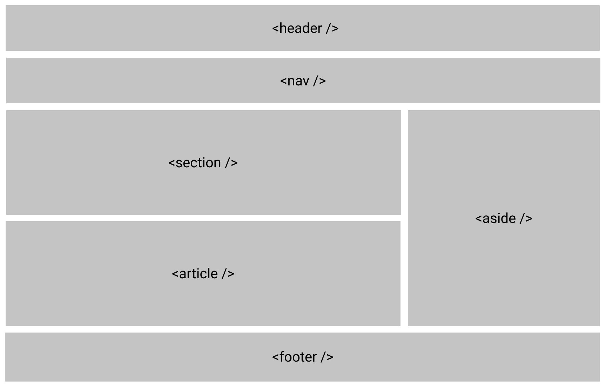
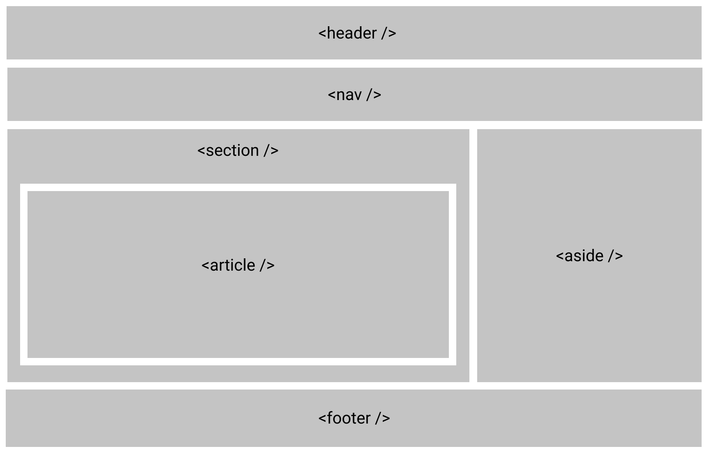
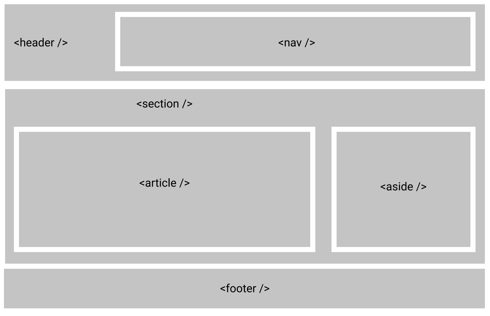
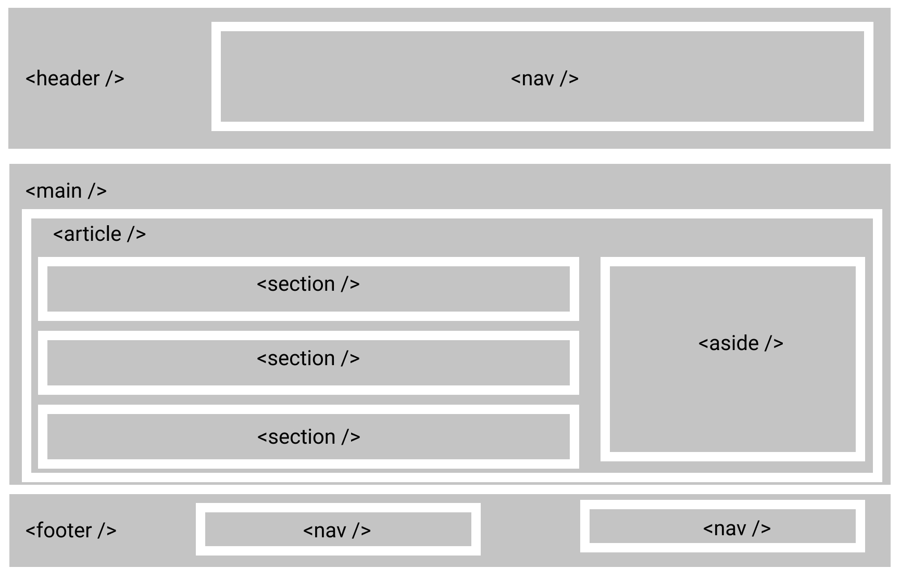

HTML elements do more than hold content. They communicate what a part of the page **is**: navigation, the main content, a standalone article, or a footer. A `div` is useful for grouping or styling, but it has no meaning of its own.

Compare a page built entirely from generic containers:

```html
<div class="header">
  <div class="nav">...</div>
</div>
<div class="content">
  <div class="post">...</div>
</div>
<div class="footer">...</div>
```

With one that expresses the same structure in HTML:

```html
<header>
  <nav aria-label="Primary">...</nav>
</header>
<main>
  <article>
    <h1>Choosing semantic HTML elements</h1>
    <p>...</p>
  </article>
</main>
<footer>...</footer>
```

The second version gives browsers and assistive technology meaningful landmarks. It is also easier to scan in the source. Semantic markup can help search engines understand a page, but it is not a shortcut to a higher ranking.

## Pick elements by purpose

| Element                   | Use it for                                                                                                |
| ------------------------- | --------------------------------------------------------------------------------------------------------- |
| `header`                  | Introductory content for a page or section; it does not always mean the site header.                      |
| `nav`                     | A section of important navigation links. Label multiple navigation regions so users can distinguish them. |
| `main`                    | The page's dominant content. A page should generally have one visible `main`.                             |
| `article`                 | A self-contained item that could stand on its own, such as a blog post.                                   |
| `section`                 | A thematic group of content, usually with a heading. Do not use it solely as a styling wrapper.           |
| `aside`                   | Content related to, but separate from, the surrounding content.                                           |
| `footer`                  | Footer content for a page or section.                                                                     |
| `h1`–`h6`                 | Headings that give the content a navigable structure. Choose levels for hierarchy, not font size.         |
| `figure` and `figcaption` | A self-contained illustration, code sample, or image with an optional caption.                            |
| `details` and `summary`   | A disclosure that a reader can open or close.                                                             |
| `time`                    | A date or time, optionally with a machine-readable `datetime` value.                                      |

For example, you can make a publication date readable to both people and software:

```html
<time datetime="2022-02-06">February 6, 2022</time>
```

Start with the element that matches the content's meaning. If none does, a `div` or `span` is perfectly fine; semantic HTML is about choosing deliberately, not replacing every generic container.

## Visual examples









**Further reading:** [MDN's HTML element reference](https://developer.mozilla.org/en-US/docs/Web/HTML/Element) and the [HTML Living Standard's sections](https://html.spec.whatwg.org/multipage/sections.html).
