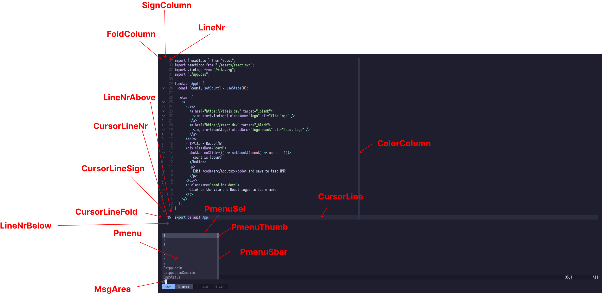
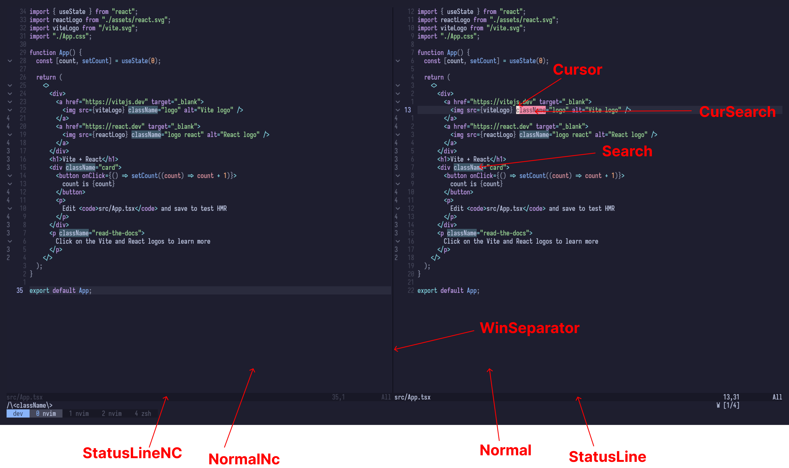
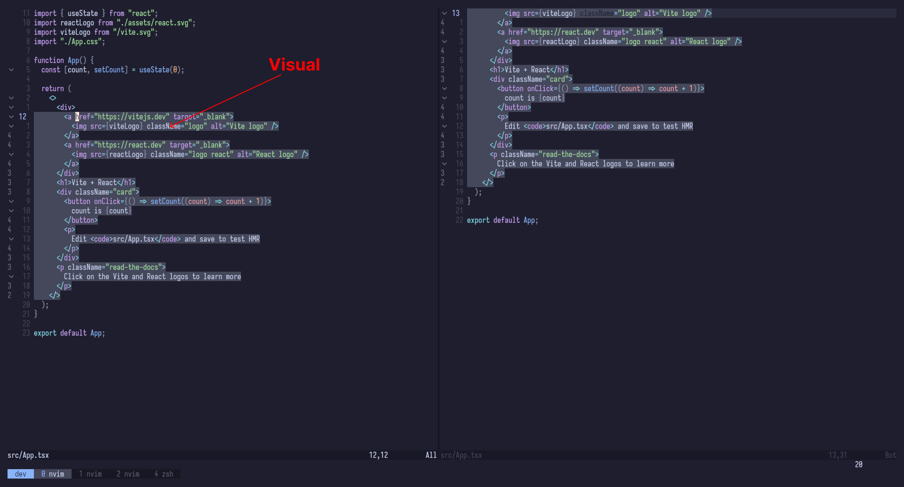
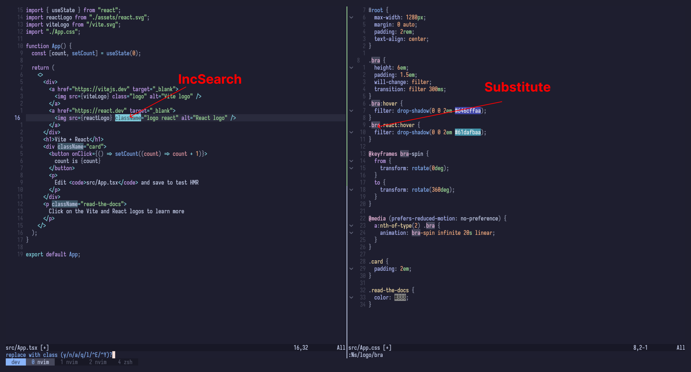
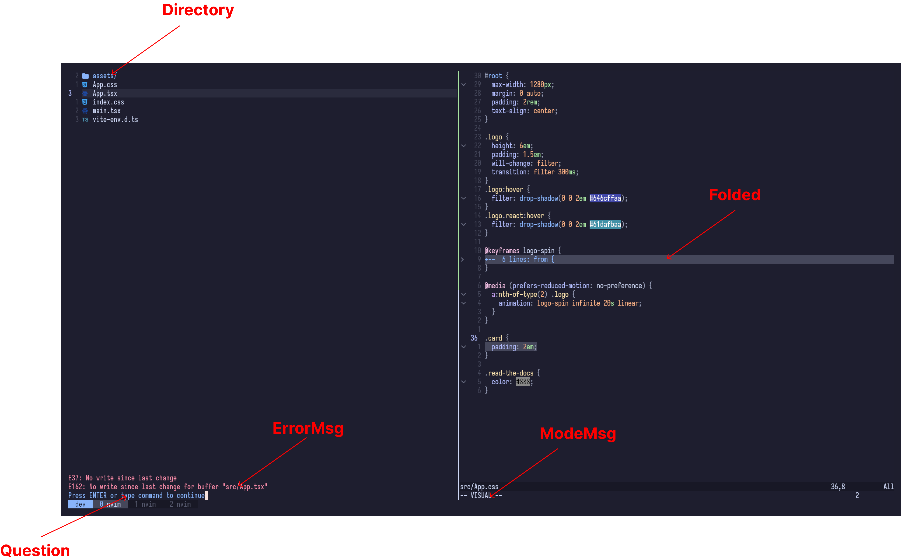

Vim and Neovim assign **highlight groups** to pieces of the editor UI. A colorscheme styles those groups; knowing their names makes it easier to adjust the part of the editor you actually want to change.

In Neovim, inspect the style of a group with `:hi GroupName`. For example, `:hi CursorLineNr` shows the highlight used for the number on the cursor line. You can try a change with `:hi CursorLineNr guifg=#f5c2e7` (the exact color is up to you).

## Gutter and cursor line

| Group                               | What it styles                                          |
| ----------------------------------- | ------------------------------------------------------- |
| `ColorColumn`                       | Columns marked by the `colorcolumn` option.             |
| `CursorLine`                        | The line under the cursor when `cursorline` is enabled. |
| `FoldColumn`                        | The fold column.                                        |
| `SignColumn`                        | The column containing signs, such as diagnostics.       |
| `LineNr`                            | Line numbers shown by `number` or `relativenumber`.     |
| `LineNrAbove` / `LineNrBelow`       | Relative line numbers above and below the cursor.       |
| `CursorLineNr`                      | The line number on the cursor line.                     |
| `CursorLineFold` / `CursorLineSign` | The fold and sign columns on the cursor line.           |

## Menus and messages

| Group                      | What it styles                          |
| -------------------------- | --------------------------------------- |
| `Pmenu` / `PmenuSel`       | Popup-menu items and the selected item. |
| `PmenuSbar` / `PmenuThumb` | The popup-menu scrollbar and its thumb. |
| `MsgArea`                  | The command-line message area.          |

## Text, search, and windows

| Group                         | What it styles                                        |
| ----------------------------- | ----------------------------------------------------- |
| `Normal` / `NormalNC`         | Ordinary text in the current and non-current windows. |
| `Cursor`                      | The character cell under the cursor.                  |
| `Search`                      | Matches for the last search pattern.                  |
| `CurSearch`                   | The current search match.                             |
| `StatusLine` / `StatusLineNC` | Status lines in the current and non-current windows.  |
| `WinSeparator`                | The separator between split windows.                  |

## Selections and substitutions

`Visual` styles the text selected in Visual mode.

`IncSearch` highlights a match during an incremental search. `Substitute` styles replacement text during a substitution preview.

## Other useful groups

| Group       | What it styles                         |
| ----------- | -------------------------------------- |
| `Directory` | Directory names in file listings.      |
| `ErrorMsg`  | Error messages.                        |
| `Folded`    | The text shown for a closed fold.      |
| `ModeMsg`   | Mode messages, such as `-- INSERT --`. |
| `Question`  | Prompts and questions.                 |

Group availability and appearance can vary by Vim/Neovim version and colorscheme. To explore more, run `:help highlight-groups` in your editor.
